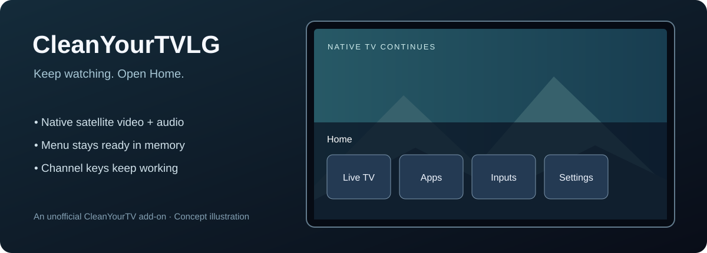

# CleanYourTVLG

**Keep watching. Open Home. Keep the remote working.**

A fast Home overlay for rooted LG webOS TVs, built as an unofficial add-on to [CleanYourTV for webOS](https://github.com/lasharor/cleanyourtv-WebOS). Your last native satellite channel keeps playing behind the menu, with its original audio.



> **Experimental preview — v0.5.0.** The runtime has been tested on one LG 50NANO796NE running webOS SDK 5.6.2. The portable installer is new; a fresh installation on another TV has not yet been verified. This is not an LG product or an official CleanYourTV release.

## What you get

- **Live broadcast behind Home.** Keep LG's native tuner and decoder running while browsing the menu.
- **A menu kept ready in memory.** Hidden preparation avoids starting the web app from scratch each time.
- **Working channel +/− buttons.** While the menu is open, channel commands reach LG's player. When hidden, the overlay releases remote focus.
- **Home and Back to dismiss.** The menu disappears while the process remains ready for the next Home press.
- **LG's loading indicator on a cold start.** No extra “loading menu” message.
- **Home only when requested.** Suppress automatic Home takeover at power-on/preload while allowing invisible preparation.
- **A native Live TV shortcut.** The menu's Live TV button returns to broadcast TV instead of requesting an IPTV playlist.
- **The familiar CleanYourTV layout.** App shortcuts, icons, customization and translations come from the upstream project.

No PC or external server is needed after installation. This add-on does not provide TV channels, playlists, subscriptions or faster satellite tuning. Apps such as Prime Video and YouTube retain their own loading behavior.

## Quick start

1. Use a **rooted TV with Homebrew Channel** and an existing root shell. Rooting is a separate process: see [webOS Homebrew](https://www.webosbrew.org/).
2. Install and finish setting up **CleanYourTV 1.6.10**, including its **Input key** integration. Use the [upstream installation guide](https://lasharor.github.io/cleanyourtv-WebOS/install/); release [v1.6.10](https://github.com/lasharor/cleanyourtv-WebOS/releases/tag/v1.6.10) is the supported base for this preview.
3. In a **root shell on the TV**, run:

   ```sh
   curl -fsSL https://raw.githubusercontent.com/rtsa/CleanYourTVLG/v0.5.0/install.sh -o /tmp/cleanyourtvlg-install.sh
   sh /tmp/cleanyourtvlg-install.sh --check
   sh /tmp/cleanyourtvlg-install.sh
   ```

4. Open a native broadcast channel and press **Home**. Press **Back** or **Home** to return. Reboot once when convenient to apply the boot policy; the installer does not reboot for you.

The installer downloads a versioned release and checks its SHA-256 files. You can inspect the scripts before running them. **Do not run these commands on your computer's shell**; connect to the TV first, for example `ssh root@TV_IP` after replacing `TV_IP` with your TV's address.

For an offline bundle, updates, installation details and recovery, read **[Installation](docs/INSTALLATION.md)**. For supported versions, read **[Compatibility](docs/COMPATIBILITY.md)**.

## Restore the previous behavior

Run on the TV:

```sh
sh /media/developer/cleanyourtv/undo-satellite-menu.sh
```

This disables the add-on and restores its saved Home binding, supported Home scripts and relevant menu settings. Later changes made outside the add-on are preserved where detectable. CleanYourTV, root access, SSH/Telnet settings and the Input binding are left in place. The inactive overlay package and backups remain for inspection. See [recovery details](docs/INSTALLATION.md#disable-and-restore).

## What has been tested

On the test TV, three consecutive warm opens reported the first menu frame in **299–318 ms** from the controller request. The same web process remained resident, and the native video connection and audio stayed active. These are software timing reports, not high-speed-camera input-to-photon measurements.

Remote-input simulation changed the actual channel **20 → 21 → 20**, with channel-up while the menu was visible and channel-down after hiding. Back dismissal and focus returning to native TV were also verified. The existing private installation was used for these tests; the new portable installer still needs independent fresh-install reports.

## Development

Python 3.9+ and Node.js are enough for the local checks and packaging; no npm installation is required.

```sh
python tools/build_ui.py
node tests/run.js
python tools/build_release.py
```

The runtime targets **Node.js 8.12** and **Chromium 68**. Do not introduce newer runtime APIs without compatibility checks. Release artifacts are written to `dist/`. See [Architecture](docs/ARCHITECTURE.md) and [Contributing](CONTRIBUTING.md).

## Credits and license

MIT. The base UI and icon are from **[lasharor/cleanyourtv-WebOS](https://github.com/lasharor/cleanyourtv-WebOS)**, version 1.6.10. Their copyright and license are retained in [vendor/cleanyourtv/LICENSE](vendor/cleanyourtv/LICENSE). This repository adds the native-TV overlay, resident lifecycle, input handling, boot policy and installer. See [Third-party notices](THIRD-PARTY.md).

LG and webOS are trademarks of LG Electronics. This independent project is not affiliated with or endorsed by LG Electronics or the upstream CleanYourTV maintainers.
